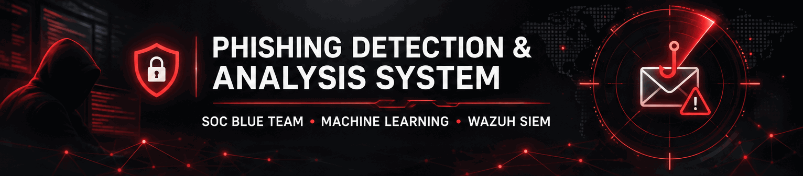
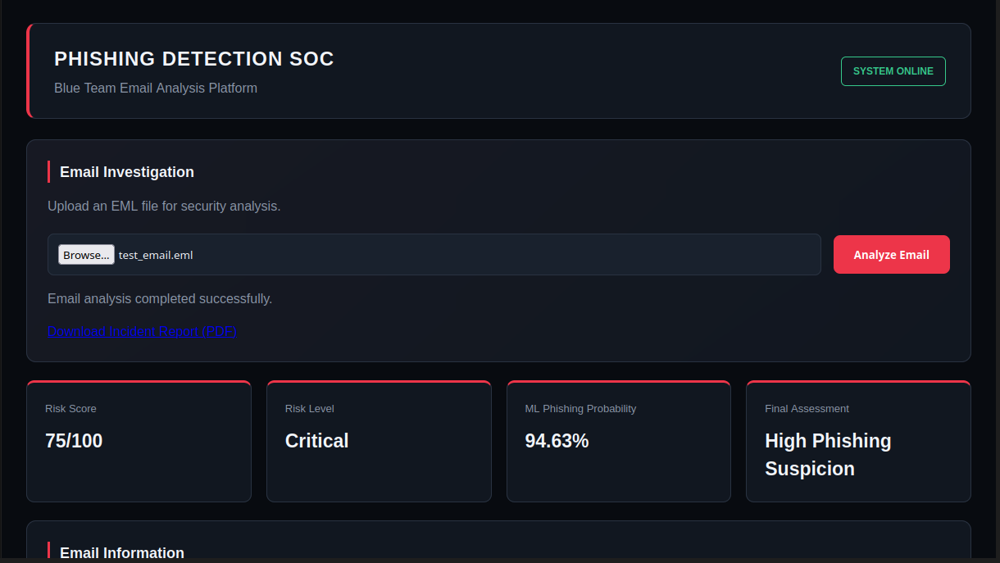
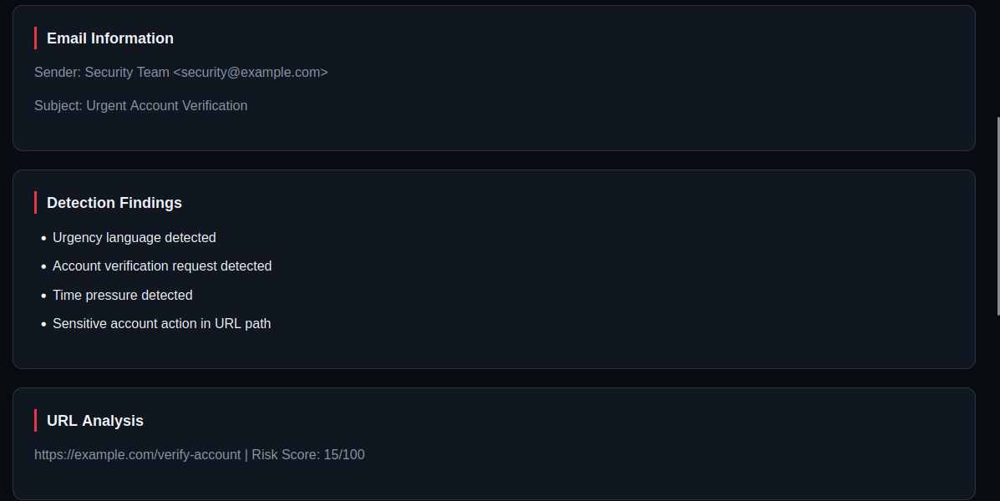
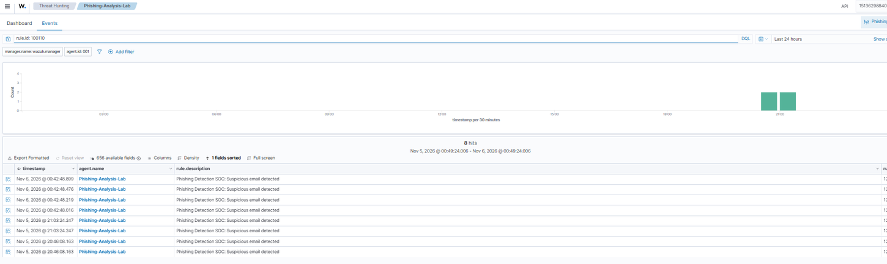
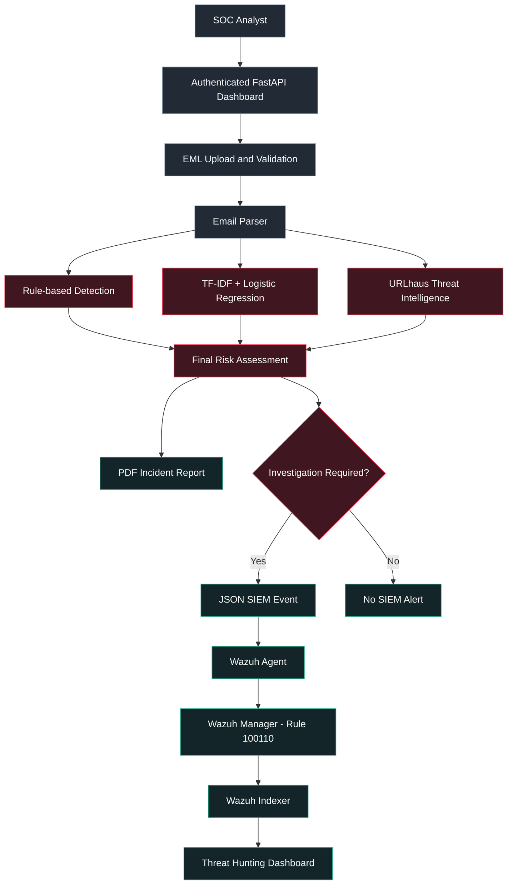

<div align="center">
  

  <h1>Phishing Detection &amp; Analysis System</h1>
  <p><strong>SOC Blue Team · Email Threat Analysis · Incident Triage</strong></p>
  <p>
    An end-to-end graduation project combining email forensics, rule-based detection,
    machine learning, threat intelligence, and Wazuh SIEM alerts.
  </p>

  <p>
    <a href="https://github.com/Elgazar1414/phishing-detection-soc/releases/tag/v0.2.0"></a>
    
    
    
  </p>
  <p>
    <a href="#quick-start">Quick Start</a> ·
    <a href="#architecture">Architecture</a> ·
    <a href="#evaluation">Evaluation</a> ·
    <a href="#wazuh-siem-integration">Wazuh Integration</a> ·
    <a href="https://github.com/Elgazar1414/phishing-detection-soc/releases/tag/v0.2.0">Download Release</a>
  </p>
</div>

---

## At a glance

| Email dataset after cleaning | Held-out test emails | Test accuracy | F1-score | Automated tests |
|:--:|:--:|:--:|:--:|:--:|
| **17,521** | **3,505** | **98.32%** | **97.76%** | **13 / 13 passed** |

> Model metrics come from the project's held-out dataset. They are not a guarantee of performance on emails from other sources.

## See it working

### SOC analysis dashboard



### Detection indicators



### Wazuh Threat Hunting



The screenshots show an actual lab run using synthetic test email samples. Wazuh rule **100110** produced **level 12** alerts with MITRE ATT&CK technique **T1566 (Phishing)**.

## Architecture



The analysis application runs on an Ubuntu VirtualBox VM. A Wazuh agent forwards JSON alerts to a Wazuh single-node deployment running in Docker on a separate Windows host.

## Detection capabilities

| Layer | What it checks |
|---|---|
| Email inspection | Sender, subject, message body, URLs, attachments, and selected headers |
| Authentication inspection | SPF, DKIM, and DMARC results when present; unverified headers are not treated as trusted proof |
| Rule-based engine | Urgent wording, account verification language, URL risk, sender mismatch, and attachment indicators |
| Machine learning | TF-IDF features with a balanced Logistic Regression classifier |
| Threat intelligence | URLhaus lookup; a URL not listed there is **not** automatically safe |
| SOC response | Risk assessment, structured JSON alert, PDF incident report, MITRE T1566 mapping |
| Access control | HTTP Basic Authentication for the dashboard, analysis API, and report download |

## Example investigation

Both files below are synthetic samples shipped in `samples/`.

| Signal | `test_email.eml` | `benign_email.eml` |
|---|---|---|
| Rule score | **75 / 100** | **0 / 100** |
| Risk level | Critical | Low |
| ML phishing probability | **94.63%** | 18.57% |
| Assessment | High Phishing Suspicion | Low Phishing Suspicion |
| Wazuh event | Generated | Not generated |
| PDF report | Generated | Generated |

## Evaluation

A cleaned dataset of **17,521 unique emails** was split into training (**14,016**) and held-out testing (**3,505**) with group-aware separation. The classifier uses TF-IDF n-grams and Logistic Regression.

| Metric | Value |
|---|---:|
| Accuracy | **98.32%** |
| Precision | **97.28%** |
| Recall | **98.24%** |
| F1-score | **97.76%** |
| False positive rate | **1.64%** |

**Confusion matrix**

| | Predicted safe | Predicted phishing |
|---|---:|---:|
| Actual safe | 2,160 | 36 |
| Actual phishing | 23 | 1,286 |

These measurements describe the evaluated distribution. Real-world phishing campaigns, novel payloads, and changes in language may affect performance. Analysts should verify findings before confirming an incident.

## Quick start

### 1. Clone and install

```bash
git clone https://github.com/Elgazar1414/phishing-detection-soc.git
cd phishing-detection-soc
python3 -m venv .venv
source .venv/bin/activate
python -m pip install -r requirements.txt
```

### 2. Configure credentials

Create a `.env` file in the project root:

```dotenv
SOC_DASHBOARD_USERNAME=socadmin
SOC_DASHBOARD_PASSWORD=replace_with_a_strong_unique_password
URLHAUS_AUTH_KEY=your_optional_urlhaus_auth_key
```

The URLhaus API key is needed for authenticated lookups. The local `.env` file is excluded from Git.

### 3. Run the SOC dashboard

```bash
python -m uvicorn app.main:app --host 127.0.0.1 --port 8000
```

Open **http://127.0.0.1:8000/dashboard** on the same machine and sign in with your configured SOC credentials. Upload an `.eml` file to start an investigation.

### 4. Run tests

```bash
python -m unittest discover -s tests -v
```

The project has **13 automated tests** covering authentication, file validation, reports, downloads, and mocked pipeline behavior. Full SIEM connectivity was verified separately in the lab.

## Wazuh SIEM integration

The application writes JSON detection events to:

```text
logs/phishing_alerts.json
```

To connect Wazuh in your own lab:

1. Install/register the Wazuh agent on the analysis machine.
2. Add the `<localfile>` block from [`integration/wazuh/agent-localfile.xml`](integration/wazuh/agent-localfile.xml) inside the agent's existing `/var/ossec/etc/ossec.conf`. Replace its placeholder path with the absolute project log path.
3. Place [`integration/wazuh/phishing_detection_rules.xml`](integration/wazuh/phishing_detection_rules.xml) in the manager's `/var/ossec/etc/rules/` directory.
4. Confirm parent rule `86600` exists for your Wazuh version and validate using `wazuh-logtest` before restarting the agent/manager.
5. Upload the synthetic phishing sample and inspect **Threat Hunting** for rule **100110**, level **12**, technique **T1566**.

The template is for the tested lab setup; adapt paths and rule compatibility to your deployment.

## Repository structure

```text
app/                  FastAPI API, parsing, detection, ML inference and reporting
app/static/           Dashboard CSS and JavaScript
app/templates/        Dashboard HTML
models/               Trained phishing classifier
samples/              Synthetic EML samples
integration/wazuh/    Agent localfile and detection-rule templates
tests/                Automated test suite
assets/               README presentation images and animation
requirements.txt      Python dependencies
README.md             Documentation
```

Local dataset files (`data/`), generated logs (`logs/`), generated reports (`reports/`), `.env`, and `.venv` are intentionally excluded from Git.

## Security and scope

- File upload checks enforce `.eml` extension, a **5 MB** limit, non-empty content, and basic sender-header validation.
- Report downloads validate filenames and require credentials.
- The dashboard uses HTTP Basic Authentication; keep this development instance bound to localhost and use HTTPS before any external deployment.
- Treat uploaded emails and generated incident reports as sensitive investigation material.
- This is a working graduation/lab prototype, not a production security gateway.

## Project release

<div align="center">
  <p><strong>Version v0.2.0</strong></p>
  <p>
    <a href="https://github.com/Elgazar1414/phishing-detection-soc/releases/tag/v0.2.0">
      
    </a>
    <a href="https://github.com/Elgazar1414/phishing-detection-soc/releases/download/v0.2.0/Phishing-Detection-SOC-v0.2.0.zip">
      
    </a>
  </p>
  <sub>Original application source, model, and release archive remain unchanged by the README presentation update.</sub>
</div>
